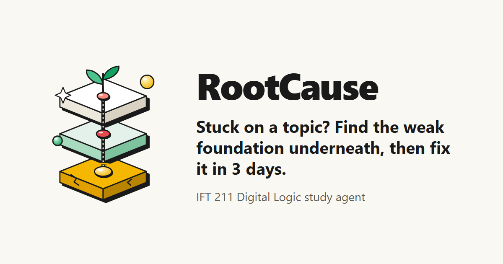
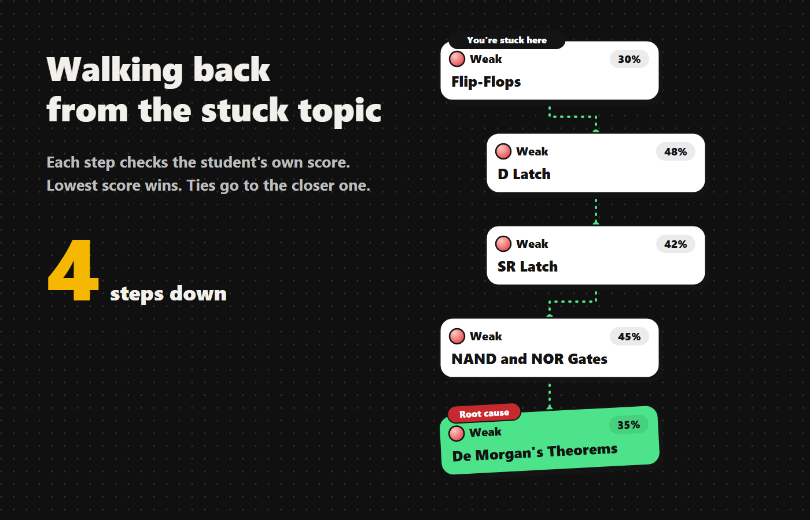
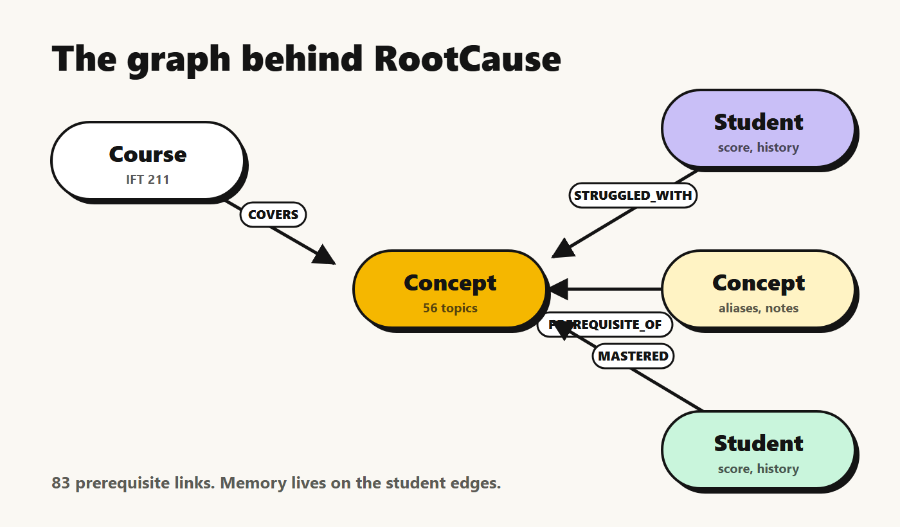
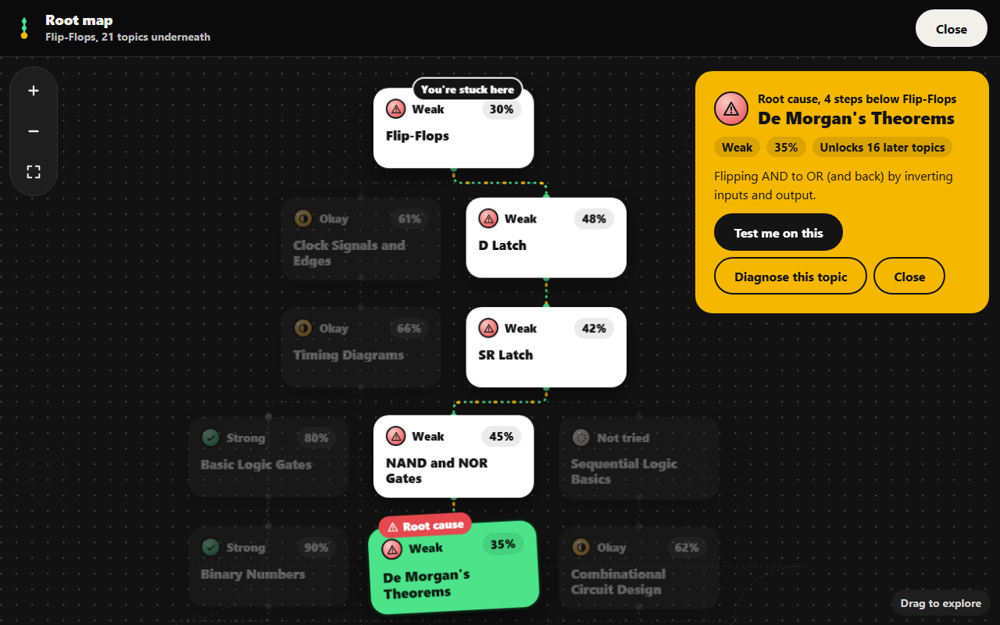
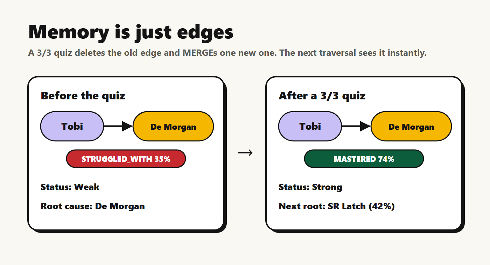
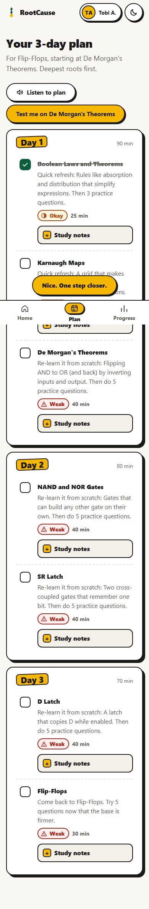

# Your student isn't bad at flip-flops. They're bad at De Morgan's theorems.

*How I built RootCause, a study agent that uses a graph database to find the real reason a topic feels hard.*


*RootCause finds the weak foundation underneath the topic you're stuck on.*


Every semester I watch the same thing happen in IFT 211 (Digital Logic). Someone says "I don't get
flip-flops", and the fix they reach for is more flip-flop videos. Another YouTube tutorial, another past
question. And it doesn't work, because flip-flops were never the problem.

Flip-flops are built on latches. Latches are built on NAND and NOR gates. NAND and NOR gates only make
sense once De Morgan's theorems click. If De Morgan is shaky, everything stacked on top of it feels like
magic, and no amount of flip-flop practice fixes that. The weak spot is usually a few steps *underneath* the
topic you think you're stuck on.


*Walking back from Flip-Flops to the real root cause: De Morgan's Theorems.*


A gradebook can tell you a student failed flip-flops. It can't tell you why. So for the WeMakeDevs Graph
Hacks hackathon, I built something that can.

## What RootCause does

You tell it the topic you're stuck on, typed or spoken, in your own words. "k map", "demorgans", "the mux
thing" all work. RootCause then:

1. **Walks backwards** through everything that topic builds on.
2. **Checks your own scores** at every step and finds the weakest foundation: the root cause.
3. **Builds a 3-day plan** that starts at the deepest weak spot, with study notes (key points, a worked
   example and the usual trap) for every topic.
4. **Gives you a 3-question quiz** on the root cause. Your result is written back into memory, the diagnosis
   runs again, and it moves on to the next weak link.

In the demo, Tobi (a made-up student) is stuck on flip-flops. RootCause traces
Flip-Flops → D Latch → SR Latch → NAND and NOR Gates → **De Morgan's Theorems, 35%**. Tobi aces the De
Morgan quiz, the score moves from Weak 35% to Strong 74%, and the next diagnosis points at **SR Latch,
42%**. The plan moves with it.

## Why a graph?

"Why am I failing flip-flops?" is a path question. You can't answer it with rows in a table without writing
a lot of recursive code. In a graph it's one traversal.

I used **FalkorDB** as the only database. The course is a graph:

- 56 `Concept` nodes for IFT 211, joined by 83 `PREREQUISITE_OF` edges ("you need this before that").
- Each student is linked to concepts by `STRUGGLED_WITH` or `MASTERED` edges that carry their latest score
  and history.


*The graph: courses, concepts, prerequisites, and students linked by what they've struggled with or mastered.*


The core diagnosis is a variable-length Cypher match that walks back from the stuck concept up to 12 hops,
keeps the shortest distance to every ancestor, and joins the student's score edges:

```cypher
MATCH (s:Student {id: $student_id}), (stuck:Concept {id: $concept_id})
MATCH p = (anc:Concept)-[:PREREQUISITE_OF*0..12]->(stuck)
WITH s, anc, min(length(p)) AS hops
OPTIONAL MATCH (s)-[r:STRUGGLED_WITH|MASTERED]->(anc)
...
ORDER BY coalesce(r.score, 101) ASC, hops ASC
LIMIT 1
```

Lowest score wins, and ties go to the closer ancestor. It's simple enough to explain on a whiteboard, which
mattered to me. Every query in the project lives in one file, `queries.py`, with a plain-English comment
above it.

The rest of the product is graph work too:

- **The chain** you see on screen is the shortest prerequisite path from the root cause to your topic,
  picking the path through your weakest concepts.
- **The plan** is every weak ancestor, ordered by depth so foundations come first, then split into three
  days, all in Cypher.
- **Topic matching** uses FalkorDB's built-in full-text index over concept names and spoken aliases, so
  "flip flops", "k-map" and "demorgans law" all land on the right concept, with a confidence score that
  decides between "got it" and "Did you mean...?".
- **The Root map** draws the whole root system under a topic (21 concepts under flip-flops). You can pan,
  zoom and tap any card to trace it.


*The Root map: every topic underneath Flip-Flops.*


## Memory is just edges

The hackathon track was Agent Memory and Coordination, and this is the part I'm proudest of. RootCause
doesn't keep memory somewhere else. **The memory is the graph.**

When you finish a quiz, one query finds your old edge to that concept, keeps its history, deletes it, blends
the old and new score, and MERGEs exactly one new edge: `MASTERED` if you're at 60% or more, otherwise
`STRUGGLED_WITH`. The next traversal sees the change straight away, so the diagnosis is always based on what
you know *now*.


*One quiz rewrites one edge, and the next diagnosis moves on.*


Even the AI's work becomes memory. When the AI writes study notes for a topic that doesn't have any yet,
they're saved back onto that concept node, so they're written once and served from the graph after that.

## Where the AI fits (and where it doesn't)

The graph makes every decision. The AI only puts the answer into words. The root cause, score and chain go
to a fast model (Groq), which writes a two-sentence explanation in the voice of a calm older student: *"Fix
the Gray code step first. Once the map lines up, the simplifications become clear, no wahala."*

I was strict about one rule: **the AI never makes a student wait.** The result shows instantly with a
template sentence, and the AI version swaps in about a second later. Every AI feature has a fallback: a
hand-written question bank, notes built from the graph, templates. With no API key at all, the app still
works.

## Built for real students

Most of my classmates study on Android phones with patchy data, so RootCause is a mobile-first app you can
install, and it keeps your last result offline. You can speak your topic and your quiz answers ("option B",
"the second one"), and Listen buttons read the diagnosis and plan aloud. Audio never leaves the phone; only
the final words do. You can share your plan to your study group on WhatsApp in one tap.


*The 3-day plan, with study notes for every topic.*


Accessibility wasn't an afterthought: the chain is a real ordered list for screen readers, status is always
an icon plus a word (never colour alone), touch targets are 48px, and Lighthouse scores Accessibility 100.

## What I learned

- **Pick the data model that matches the question.** Once I stored prerequisites as edges, "find the root
  cause" stopped being an algorithm and became a query.
- **Keep the graph as the source of truth.** Scores, history, notes and plans all come from traversals, so
  there's nothing to keep in sync.
- **Make AI optional, not load-bearing.** The demo never breaks because a model is slow or a key is missing.
- **Build with an agent, but stay the editor.** I built RootCause with Claude Code as my pair programmer. It
  wrote most of the code and ran the testing and design QA loops while I set the direction and reviewed every
  decision. That's how a full product fit into one hackathon day.

## Try it

- Live app: https://rootcause-production-b767.up.railway.app
- Code: https://github.com/divinefavourak/rootcause
- Demo video: https://youtu.be/L5zA-IDoVHY

Pick Tobi, type "I don't get flip flops", and watch it find De Morgan's theorems. Then take the quiz and
watch the root move.

The data is all made up, so play around. And if you're stuck on something right now, there's a good chance
the real problem is a few steps underneath it.
