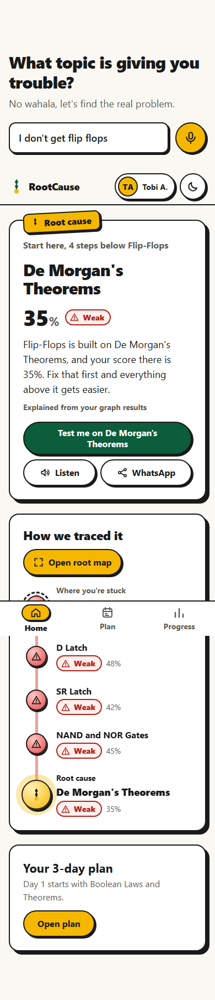
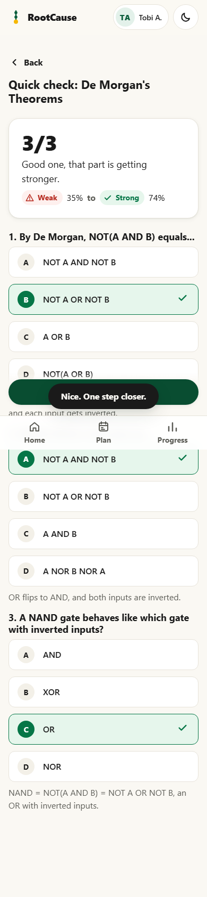
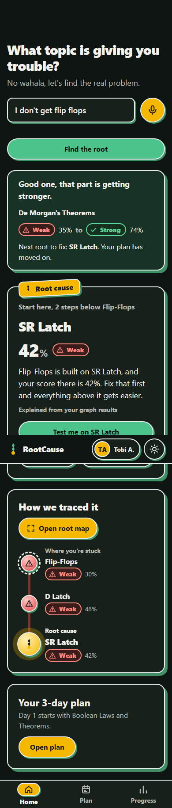
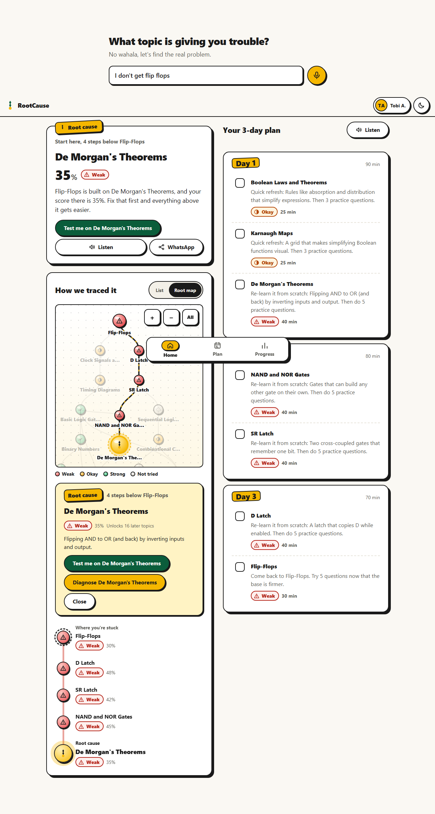

# RootCause

**Find the real reason a topic feels hard.**

A student says *"I don't get flip-flops."* RootCause walks backwards through a prerequisite graph in
**FalkorDB**, finds the weakest concept underneath (for our demo student: De Morgan's Theorems, 35%,
four steps down), and gives a 3-day plan that starts there. A quick 3-question quiz writes the result
back into the student's memory graph, and the next diagnosis changes live.

Built for the **WeMakeDevs Graph Hacks** hackathon. Track: **Agent Memory and Coordination**.

**Live demo:** https://rootcause-production-b767.up.railway.app (landing) and
https://rootcause-production-b767.up.railway.app/app (the app).

<p>
  
  
  
</p>


---

## Why a graph

"Why am I failing flip-flops?" is a path question. Flip-flops are built on latches, which are built on
NAND/NOR gates, which only make sense once De Morgan's theorems click. A table of scores can't tell you
which low score is *to blame*; a traversal can. In RootCause:

- **Diagnosis** is a variable-length traversal *backwards* along `PREREQUISITE_OF`, joined with the
  student's own `STRUGGLED_WITH` / `MASTERED` edges.
- **The plan** is the set of weak ancestors, ordered by depth so foundations come first.
- **Memory** is the edges themselves. A quiz result deletes the old edge and MERGEs the right one,
  so the graph *is* the student's memory, and the next traversal sees it immediately.

Remove FalkorDB and nothing works: there is no other database.

## Graph model

```
(:Course {code})-[:COVERS]->(:Concept {id, name, unit, aliases, summary})
(:Concept)-[:PREREQUISITE_OF]->(:Concept)
(:Student {id, name})-[:STRUGGLED_WITH {score, date, history}]->(:Concept)
(:Student)-[:MASTERED {score, date, history}]->(:Concept)
```

Seeded with a synthetic **IFT 211 Digital Logic** course: **56 concepts**, **83 prerequisite edges**,
spoken-form aliases ("k map", "karnaugh", "demorgans", "mux"), and **2 invented students** with score
history. No real personal data anywhere.

## The queries (all in [`app/queries.py`](app/queries.py))

Every Cypher statement lives in one file with a plain-English comment above it.

| Query | What it does in plain English |
|---|---|
| `ROOT_CAUSE` | Walk back from the stuck topic to every ancestor (`*0..12`), keep the shortest hop count to each, join the student's score. Among the ones they struggled with, lowest score wins; ties go to the closer one. The stuck topic itself is only chosen if nothing underneath is weak. |
| `ROOT_CHAIN` | Among the shortest paths from the root cause up to the stuck topic, pick the one running through the weakest concepts (pattern comprehension scores each path), and return each step with its status. This is the "root line" on screen. |
| `UPDATE_MASTERY` | Find the old `STRUGGLED_WITH`/`MASTERED` edge, keep its history, delete it, blend old and new score (new counts 60%), then `MERGE` exactly one new edge: `MASTERED` at 60% or more, else `STRUGGLED_WITH`. Returns before and after. |
| `FIX_PLAN` | Every weak ancestor, deepest first (longest path back), weakest first within a depth, with the stuck topic last, split into Day 1/2/3 by position. |
| `STUDENT_OVERVIEW` | Every concept with Weak (<50) / Okay (50–69) / Strong (70+) / Not tried, plus how many later topics it unlocks (downstream traversal). |
| `RESOLVE_CONCEPT` | FalkorDB full-text index (RediSearch, English stemming) over name and aliases, with fuzzy and prefix terms. Exact or whole-phrase alias matches rank first; confidence decides between auto-select and "Did you mean...?" chips. |
| `CONCEPT_NOTES` / `SAVE_NOTES` | Study notes for every topic in a plan, read off the Concept node with what it builds on and leads to. Notes Claude writes are saved back onto the node, so each is generated once and then served from the graph. |
| `QUIZ_FACTS` | When there is no LLM and no hand-written question bank, builds a quiz from the graph itself: "Which topic should you learn before X?" (answer: a real prerequisite; distractors: things that come *after* X). |
| `ROOT_SYSTEM_NODES` / `ROOT_SYSTEM_EDGES` | Everything upstream of the stuck topic (its whole "root system") with hop distance and how many topics each unlocks, plus the edges between them. Feeds the interactive Root map. |

Run them all against a throwaway graph:

```bash
python -m scripts.test_queries     # seeds rootcause_test, prints every result, 15 checks, deletes it
```

## Demo script (2 minutes)

1. Pick **Tobi A.**, type or say *"I don't get flip flops"*.
2. The root line draws itself: Flip-Flops → D Latch → SR Latch → NAND and NOR Gates → **De Morgan's Theorems (35%)**.
3. Tap **Test me on De Morgan's Theorems**, answer 3 questions (tap or say "B", "the second one").
4. **See what changed**: the De Morgan node heals from Weak to Strong, the line turns green, and the
   diagnosis re-runs: the next root is **SR Latch (42%)**. The plan moves on with it.
5. Open **Root map**: the whole upstream root system of Flip-Flops (21 concepts). Drag to pan, zoom,
   tap any node to light its path up to the stuck topic, and diagnose from there.
6. Progress tab: every topic in the course, grouped by unit, with the count of topics each one unlocks.
7. Try **Amaka E.** with *"k map"*: root cause is **Gray Code**.

## Stack

- **FalkorDB** (graph DB, full-text index) via Docker, Python client `falkordb`
- **three.js 0.170** (vendored in `app/static/vendor/`, MIT) for the 3D hero scene. It loads lazily after
  the page is usable and falls back to an inline SVG without WebGL. It is the one heavy asset
  (~170 KB gzipped); everything else on a page is ~30 KB.
- **FastAPI** backend, plain **HTML/CSS/vanilla JS** frontend served by FastAPI. No framework, no CDN,
  no web fonts, about 30 KB gzipped for the whole page.
- **AI via OpenRouter** (optional, any model; default `nvidia/nemotron-3-super-120b-a12b:free`) only for a
  friendly explanation, quiz questions for topics without a hand-written set, and study notes. Every call
  runs off the request path or under a hard deadline, so the app never waits on it. With no
  `OPENROUTER_API_KEY` the app uses template text, the question bank and graph-built notes.
- **Voice** via the browser's Web Speech API (en-NG first, en-US fallback) and `speechSynthesis` for
  Listen buttons. **No audio is ever recorded or sent**; only the final text goes to the backend.
  Typing always works; speech never auto-submits.
- **PWA**: manifest, maskable icons, service worker caching the shell and the last diagnosis.

Lighthouse (mobile, local): Accessibility 100, Best Practices 100, SEO 100 on both pages. Performance is
76 (landing) / 73 (app) with the 3D scene and 99 without it: the gap is three.js parse and shader compile
on Lighthouse's throttled, GPU-less CPU.

## API

| Method | Path | Body / params |
|---|---|---|
| GET | `/api/students` | |
| GET | `/api/concepts` | |
| GET | `/api/concepts/resolve?q=` | free text, e.g. `I don't get flip flops` |
| POST | `/api/diagnose` | `{student_id, concept_id}` |
| POST | `/api/quiz/generate` | `{student_id, concept_id}` |
| POST | `/api/quiz/submit` | `{student_id, quiz_id, stuck_id, answers: [0-3 or null]}` |
| GET | `/api/overview/{student_id}` | |
| GET | `/api/health` | |

## Run it locally

Needs Docker and Python 3.11+.

```bash
docker compose up -d                 # FalkorDB on :6379 (browser UI on :3000)
pip install -r requirements.txt
python -m scripts.seed               # loads IFT 211 + 2 demo students
uvicorn app.main:app --reload        # landing: http://localhost:8000  app: http://localhost:8000/app
```

Optional: `cp .env.example .env` and set `OPENROUTER_API_KEY` (and `OPENROUTER_MODEL`, any OpenRouter
model id). To point at **FalkorDB Cloud**, set `FALKORDB_HOST`, `FALKORDB_PORT`,
`FALKORDB_USERNAME`, `FALKORDB_PASSWORD` in `.env`, then run the seed.

On Windows without Docker Desktop: run `docker compose up -d` inside WSL from the repo folder
(`/mnt/c/...`); WSL forwards `localhost:6379` to Windows.

**One container** (FalkorDB + app together, seeds itself on first boot):

```bash
docker build -t rootcause . && docker run -p 8000:8000 rootcause
```

### Deploy

Deployed on **Railway** (`railway up`, config in `railway.json`, Dockerfile build, one container with
FalkorDB inside). FalkorDB writes to a Railway volume at `/var/lib/falkordb/data` with append-only
persistence, so student memory survives restarts; the seed only runs when the graph is empty. The same Dockerfile also deploys to **Fly.io** (`fly deploy`, config in `fly.toml`) or **Render**
(`render.yaml` blueprint, Docker runtime). Both give HTTPS, which the mic needs. Set
`FALKORDB_HOST` etc. to use FalkorDB Cloud instead of the bundled server.

### QA scripts

```bash
python -m scripts.screenshots          # every screen x 360/390/768/1280 x light/dark -> screenshots/
python -m scripts.screenshots --quick  # 360px only
python -m scripts.make_icons           # icon.svg -> PWA PNGs + og:image
```

## Design

Neobrutalist on purpose: ink outlines, hard offset shadows, buttons that physically press in, sticker
labels. One idea is repeated everywhere: the **root line**, a vertical stroke through status nodes from the
stuck topic down to the root cause (logo, splash, chain, progress list, loading skeleton). The 3D pieces
are hand-drawn inline SVG (an isometric stack of "knowledge layers" with a sprout on top and an amber root
layer, shaded spheres for every node), so there are no image downloads and they follow the theme.
The **Root map** is a hand-rolled SVG graph (no library): layered by hop distance, pan / pinch / zoom,
path highlighting, sap animation along the diagnosed chain, labels that stay 14px at any zoom.

## How the AI explanation works

The graph does the diagnosis; the AI only puts it into words.

1. `ROOT_CAUSE` and `ROOT_CHAIN` (pure Cypher) pick the root cause, its score and the chain.
2. The page shows the result straight away with a template sentence, then calls `/api/explain`.
   `app/llm.py` sends those facts, and nothing else, to the model through OpenRouter with a short persona prompt
   ("a warm, calm older student", at most 2 sentences, under 45 words). No student name or history is sent.
3. The reply is cached per (stuck topic, root, score), so a repeat diagnosis costs nothing.
4. Any failure (no key, timeout, refusal) falls back to a template built from the same facts. The UI says
   which one you're seeing ("Explained by AI from your graph results" vs "Explained from your graph results").

The same pattern drives quiz questions (hand-written bank, then graph-built questions as fallbacks) and study
notes (hand-written, then AI-written in the background and saved to the graph, then graph-built).

## Accessibility

Real ordered-list HTML for the chain (the root map is extra and the list is always there below it; map
nodes are focusable buttons with full spoken labels), status
always shown as icon + text (never colour alone), 48px touch targets, 16px body text, skip link,
visible amber focus ring, `aria-live` for loading, results and voice state, full keyboard use,
`prefers-reduced-motion` and `prefers-color-scheme` respected, plus a manual theme toggle.

## Built with Claude Code

This project was built with **Claude Code** (Anthropic's agentic coding tool) as a pair programmer:
it wrote most of the code, the seed data, the Cypher queries and this README under my direction, ran
the query tests and the screenshot/Lighthouse QA loop, and I reviewed and steered the design and
product decisions. The app can also call the Claude API at runtime for explanations and quiz
questions (optional, see above).

## Data and privacy

All course content and both students are synthetic. Nothing is collected from real people. Voice is
processed by the browser; RootCause only ever receives the final text.
